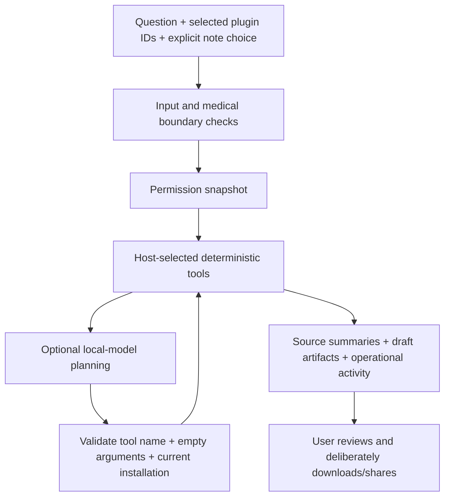

# Doctor Agent plugins · contract v1

The local web agent has a real plugin catalog, install/remove lifecycle,
conversation-scoped enablement and a bounded tool executor. Custom manifests
are stored under ignored `.local/plugins/`. Installing a manifest does not
enable it. The browser defaults to bundled tools for a new conversation.

## Install and run your first plugin

1. Start `python3 app.py` and open `http://127.0.0.1:8000`.
2. Open **Plugins & tools → Install a custom plugin**.
3. Choose **Load checklist example**, inspect its content/permissions, and
   choose **Install reviewed manifest**.
4. The new plugin appears disabled. Enable **Appointment checklist** for this
   conversation.
5. Send **Make an appointment checklist**. Inspect **Agent activity** and the
   draft artifact. Download only after reviewing its contents.
6. Remove the plugin from the panel when finished. Removing it leaves existing
   session-chat copies and downloaded drafts under your control.

The reusable example is in `plugins/examples/appointment-checklist.json`.
Custom content is labelled unreviewed, including source summaries. Installation
validation checks structure and permissions; it does not establish medical
correctness or endorse the plugin author.

## Supported operations

| Operation | Inputs supplied by the host | Output |
| --- | --- | --- |
| `reference_search` | Current question and bounded public-source entries in the manifest | Matching attributed summaries and HTTPS links; no network search |
| `visit_brief` | Current question; notes only after this turn's separate sharing checkbox | Quoted user statements and organizational questions in a draft artifact |
| `checklist` | Current question and manifest checklist items | Reviewable checklist artifact |

`read:question` and `read:notes` are checked by the executor. The manifest must
declare exactly the capabilities its operation uses. Tool arguments exposed
to a model are an empty object; the host selects the authorized question and
notes. Model-supplied paths, new health context and extra arguments are refused.

A version 1 manifest contains `schema_version`, `id`, `name`, `description`,
`version`, `operation`, `permissions`, literal `triggers`, and optional `items`
or `references`. See the checked-in example for valid JSON. Limits: 32 KB per
manifest, 32 installed plugins, 12 trigger phrases/items/references each, and
12 enabled plugins per request. IDs are lowercase letters/digits/hyphens;
built-in IDs cannot be overwritten. Newly installed references are not fetched
or fact-checked. The core library uses the existing bundled catalog.

New operation types require an explicit host implementation and policy/tests.
This first contract is data-only: it has no executable Python, shell, arbitrary
file access, portal login, external message sending or medical action handler.
It is not an MCP client. A real MCP adapter with connection-specific consent
and credentials is a later milestone.

## Agent execution

Four distinct tool executions and three model rounds are allowed per turn.
Duplicate calls reuse the earlier tool result. A run has a 45-second host
deadline checked between steps, a 20-second model socket timeout and a bounded
output budget. This is not a hard process-level execution deadline.
At most two active workers are allowed. Stop prevents subsequent host tool
execution; a blocked local-model HTTP call may take until its timeout to return.
The model process can briefly continue handling an abandoned request.

For an organizational deliverable without an existing artifact, planning uses
only the current request and the permitted artifact-tool schemas. It requires
a tool call rather than substituting a prose list. Source/notes context is
available to the subsequent answer stage only through the authorized tool
outputs. This keeps small-model tool selection focused and minimizes context.

Source/tool results remain available when the model times out or returns a
rejected draft. A no-source/no-artifact request gets clarification/abstention.
Activity shows actual policy/tool/provider events, not private model reasoning.
Model answers are labelled unverified drafts, with original summaries accessible
under Sources. Keyword guards cannot establish medical safety or grounding.

## API and privacy boundaries

| Route | Behavior |
| --- | --- |
| `GET /api/plugins` | Catalog and declared permissions |
| `POST /api/plugins/install` | Validate and install `{ "manifest": ... }` |
| `POST /api/plugins/remove` | Remove custom `{ "id": ... }` |
| `POST /api/agent/run` | Start a bounded turn; return run ID and random access token |
| `POST /api/agent/status` | Inspect `{ "id": ..., "token": ... }` |
| `POST /api/agent/cancel` | Cancel using the same run credentials |

JSON mutations require `X-Doctor-Agent: local-web`. Supplied browser origins
must match the loopback Host and port; cross-site and DNS-rebinding Host headers
are rejected. No CORS permission is granted. Run tokens are never put in URLs.
The status/stop APIs require the exact token. This is a local single-user
application, not hosted account authentication or protection against malware
running on the same computer.

Questions, notes, run results and browser chat copies stay in process/browser
memory. There is no health-text database or automatic journal write. Up to 64
runs are retained, with oldest completed runs evicted at capacity; a 30-minute
TTL is checked on access/start. Idle process memory is released on server stop,
not by a guaranteed wall-clock erasure job. Downloaded artifacts and clipboard
copies are deliberate exports and remain outside that memory lifecycle.

History supplied by the browser is untrusted. Only the three most recent user
questions can enter model context; assistant text cannot grant permissions.
Narrow follow-ups can reuse the preceding user topic. There is no longitudinal
clinical memory or reconciliation of patient records in this runtime.

The local model URL must be HTTP(S) loopback, without embedded credentials;
redirects and environment HTTP proxies are disabled. Use a genuinely local
model runtime with cloud forwarding disabled. A loopback HTTP endpoint alone
cannot prove what an independently configured inference server does next.

Protocol references for future adapters:
[Ollama tool calling](https://docs.ollama.com/capabilities/tool-calling),
[Ollama compatibility and thinking controls](https://docs.ollama.com/api/openai-compatibility),
[MCP tools specification](https://modelcontextprotocol.io/specification/2025-06-18/server/tools).
